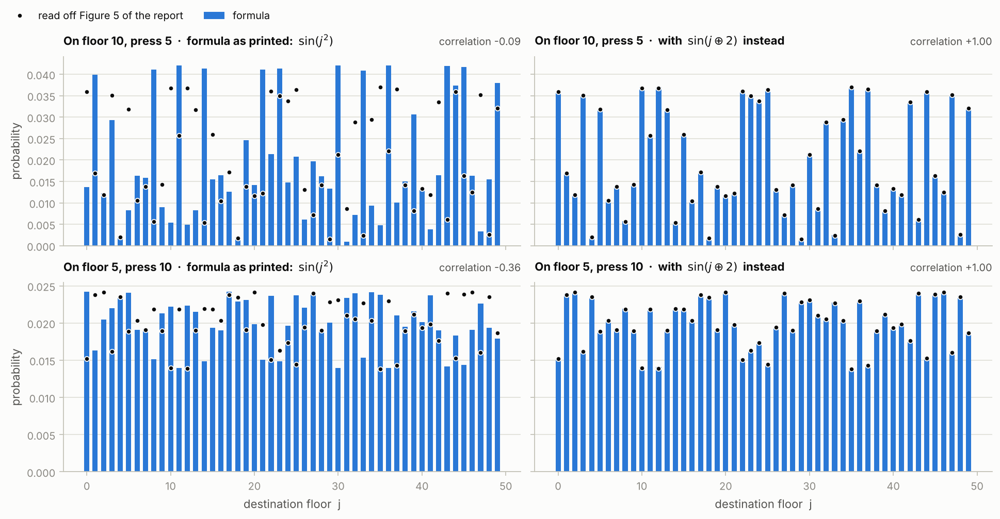
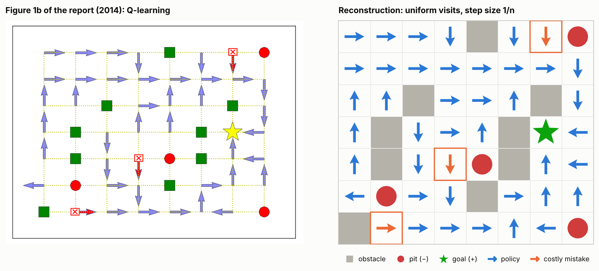
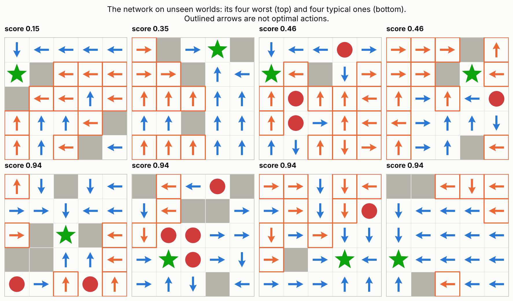

# Markov decision processes, revisited

[](https://codespaces.new/shimmeringvoid/MDP_Experiments)
[](https://colab.research.google.com/github/shimmeringvoid/MDP_Experiments/blob/main/notebooks/01_two_mdps.ipynb)
[](https://mybinder.org/v2/gh/shimmeringvoid/MDP_Experiments/main?labpath=notebooks%2F01_two_mdps.ipynb)

In spring 2014 I wrote a report for Georgia Tech's CS 7641 (Machine Learning) that compared value
iteration, policy iteration and Q-learning on two Markov decision processes of my own choosing: a
randomly generated **grid world** with pits, and a **crazy elevator** whose buttons only influence
where it goes. The [report](report/CS7641_Project3_MDP_2014.pdf) survives. The code and the data
behind it do not.

This repository

1. **rebuilds** both MDPs and all three algorithms from the text of the report, and checks the
   rebuild against the report's own figures, which were read back out of the PDF;
2. **answers** what the report observed but left open: why its Q-learner got three cells wrong, why
   policy iteration was the faster method on one MDP and the slower one on the other, why the
   elevator's rewards turn down beyond 34 floors;
3. **extends** the study with more planners, more learners and a deep Q-network, every one of them
   scored exactly against the known optimum.

Everything is in ten Jupyter notebooks, backed by a small library, `mdplab`.

## What came out of it

**The rebuild is the system the report studied.** All 42 arrows of the report's Figure 1a, all
1,238 arrows of its 39 × 39 world and all 49 buttons of its 50-floor elevator policy are optimal in
the rebuilt models. The sweep counts of its Figure 7 are reproduced as closely as the figure can
be read, and those of its Figure 2, which came from random worlds, in their spread.
([1](notebooks/01_two_mdps.ipynb), [2](notebooks/02_gridworld_planning.ipynb),
[4](notebooks/04_crazy_elevator.ipynb))

**The elevator did not run the formula that was printed.** The report gives the transition
probabilities with a term sin(j²). The bar heights of its Figure 5 do not fit that formula at all,
and fit `sin(j ^ 2)` to within 0.0002. In Python, `^` is exclusive-or, not a power. With the
exclusive-or the rebuilt policy agrees with the report's on 49 of 49 floors; with the square, on 1.
([1](notebooks/01_two_mdps.ipynb))



**The Q-learner's mistakes came from its step size.** The report's Q-learning policy differs from
the optimal one in three cells that matter. A learner that visits every state-action pair equally
often and uses a step size of 1/n makes costly mistakes in exactly those three cells in 48 of 50
runs. With a step size of 1/n<sup>0.7</sup> and the same experience, none of 50 runs makes any.
With 1/n, reaching the optimal policy would take about 10<sup>12</sup> visits to every pair.
(The report does not state its step size; 1/n is an inference from these results.)
([3](notebooks/03_gridworld_q_learning.ipynb), [5](notebooks/05_step_size_and_exploration.ipynb))



**Why policy iteration won on one MDP and lost on the other.** The report found policy iteration
slower than value iteration on the grid world and faster on the elevator, and asked why. Two things
decide it. A sweep of policy evaluation looks at one action per state where a sweep of value
iteration looks at all of them, so policy iteration gains in proportion to the number of actions:
the grid world has 4, the elevator as many as it has floors. And on the grid world, evaluating any
policy that leaves some cell bumping into a wall for ever takes 918 sweeps, about six times what
value iteration needs to solve the report's 7 × 8 world outright.
([6](notebooks/06_value_vs_policy_iteration.ipynb))

**More in the notebooks**

* Why value iteration takes 918 sweeps on so many of the grid worlds, whatever their size.
  ([2](notebooks/02_gridworld_planning.ipynb), [6](notebooks/06_value_vs_policy_iteration.ipynb))
* Why the elevator's reward peaks at 34 floors: the prize grows like 20N, the cost of the ride
  like N². ([4](notebooks/04_crazy_elevator.ipynb))
* How rewards and the discount shape the optimal policy, and what a trap on floor 13 does to the
  elevator. ([7](notebooks/07_rewards_discounting_traps.ipynb))
* Faster planners, and how far the stopping rule of value iteration is from the true error.
  ([8](notebooks/08_more_planners.ipynb))
* Q-learning next to SARSA, Expected SARSA, Double Q-learning and Dyna-Q; and how planning on a
  model estimated from 30 samples per pair beats the 5,600 that the 2014 learner consumed.
  ([9](notebooks/09_td_control.ipynb))
* A deep Q-network that is trained on random worlds and scored on worlds it has never seen: what
  it learns, what it costs, and why it should learn with a shorter horizon than it is judged by.
  ([10](notebooks/10_deep_q_networks.ipynb))



## The notebooks

| | Notebook | Contents |
|---|---|---|
| 1 | [Two MDPs](notebooks/01_two_mdps.ipynb) | The grid world and the elevator; evidence that the rebuilt versions are the report's (Figures 5 and 6) |
| 2 | [Grid world planning](notebooks/02_gridworld_planning.ipynb) | Value and policy iteration; the report's Figures 1a, 2 and 3 |
| 3 | [Grid world Q-learning](notebooks/03_gridworld_q_learning.ipynb) | The 2014 learner reconstructed; Figures 1b and 4 |
| 4 | [Crazy elevator](notebooks/04_crazy_elevator.ipynb) | Planning and learning on the elevator; Figures 7 and 8 and the tables |
| 5 | [Step size and exploration](notebooks/05_step_size_and_exploration.ipynb) | Why 1/n fails on the grid and suits the elevator; ϵ-greedy and optimistic starts |
| 6 | [Value vs policy iteration](notebooks/06_value_vs_policy_iteration.ipynb) | Which is faster, and when; modified policy iteration |
| 7 | [Rewards, discounting and traps](notebooks/07_rewards_discounting_traps.ipynb) | How the problem's parameters shape the optimal policy |
| 8 | [More planners](notebooks/08_more_planners.ipynb) | Gauss-Seidel, prioritized sweeping, modified policy iteration, linear programming |
| 9 | [TD control](notebooks/09_td_control.ipynb) | SARSA, Expected SARSA, Double Q-learning, Dyna-Q, planning on an estimated model |
| 10 | [Deep Q-networks](notebooks/10_deep_q_networks.ipynb) | A network in place of the table; generalising to unseen worlds |

Notebooks 1 to 4 reproduce the report, 5 to 7 take up the questions it left open, and 8 to 10 go
beyond it. They are stored with their outputs, so they can be read here without running anything.

## Running it

### In the browser, with nothing to install

* **GitHub Codespaces** (the first badge above) creates a machine in the cloud that holds this
  repository with the library, Jupyter and PyTorch installed. Setting it up takes a few minutes the
  first time. Then open a notebook from `notebooks/` and choose the Python kernel when asked.
* **Google Colab.** Every notebook has an *Open in Colab* badge under its title. Colab opens the
  notebook on its own, so the first code cell fetches this repository; after that the notebook
  runs as it does anywhere else.
* **Binder** (the third badge) starts JupyterLab on this repository. It installs the library but
  not PyTorch, so it runs notebooks 1 to 9.

### On your own machine

```bash
git clone https://github.com/shimmeringvoid/MDP_Experiments.git && cd MDP_Experiments
pip install -e ".[notebooks]"        # the library and Jupyter
pip install -e ".[notebooks,deep]"   # the same plus PyTorch, for notebook 10
pytest                               # about 20 seconds
jupyter lab notebooks
```

`make notebooks` runs all ten again from clean kernels, which takes about 20 minutes on a laptop.
Notebooks 1 to 9 use fixed seeds and give the same numbers on every run, timings aside. Notebook 10
trains networks, whose results can differ slightly between machines and PyTorch versions.

The stored outputs were produced with Python 3.13, NumPy 2.5, SciPy 1.18, pandas 3.0, Matplotlib
3.11 and PyTorch 2.15. The tests also pass on Python 3.10 to 3.12 and on the oldest versions of the
libraries that `pyproject.toml` allows. Notebooks 1 to 9 have also been run on Python 3.10 with
NumPy 2.2, SciPy 1.15, pandas 2.3 and Matplotlib 3.10: timings aside, every number came out the
same except one table entry in notebook 9 (4.91 instead of 4.99).

## The library

`src/mdplab` holds what the notebooks share. An MDP is a transition matrix (sparse for grid worlds,
dense for the elevator) with rewards and a discount, and everything else works on that.

```python
import mdplab as ml

world = ml.GridWorld.report_figure1()            # the 7 × 8 world of the report's Figure 1
plan = ml.value_iteration(world.mdp)             # also: policy_iteration, prioritized_sweeping, ...
print(world.policy_to_text(plan.policy))

learner = ml.synchronous_q_learning(world.mdp, 5_600, alpha=ml.polynomial(0.7), n_runs=50,
                                    scorer=ml.PolicyScorer(world.mdp))
print(learner.history["value_gap"][-1].mean())   # exact value the learned policies give up

elevator = ml.crazy_elevator(50)                 # formula="as_written" for the printed version
```

| Module | Contents |
|---|---|
| `core` | The `MDP` container, fast sampling of transitions |
| `gridworld`, `elevator`, `random_mdp` | The two MDPs of the report, and random "Garnet" MDPs |
| `planning` | Value iteration, policy iteration and four variants, with work counted in backups |
| `evaluation` | Exact policy evaluation, absorption and hitting probabilities, Monte Carlo rollouts |
| `learning` | Batched tabular learners: Q-learning, SARSA, Expected SARSA, Double Q, Dyna-Q; step-size and exploration schedules |
| `benchmark` | Exact scoring of policies over a whole set of worlds |
| `dqn` | Deep Q-learning on grid worlds (needs PyTorch) |
| `legacy` | The textbook forms of value and policy iteration that the 2014 timings were measured on |
| `report` | Numbers and layouts recovered from the report |
| `plotting` | The figure style and the grid-world drawings |

## What is known and what is inferred

The report describes its setup in a page. Whatever it does not state had to be inferred, and each
inference is tested against something the report shows.

| | Source | Check |
|---|---|---|
| Grid world: layout rules, rewards, slip probability, discount 0.99 | stated | Figures 1a and 3 are optimal for the rebuilt model, arrow for arrow |
| Elevator: rewards, prize 20N, discount | stated | 50-floor policy and Figure 7 reproduced |
| Elevator transition formula uses `j ^ 2` (exclusive-or) | inferred | Figure 5 bar heights; policy match 49 of 49 against 1 of 49 |
| Stopping rule: largest change below 10⁻⁶ | inferred | sweep counts of Figure 7 |
| Q-learning visited all state-action pairs about equally | inferred | the report's own counts: at least 5,600 visits per pair, 5,973 on average |
| Q-learning's step size was 1/n | inferred | reproduces the three mistakes of Figure 1b in 48 of 50 runs; 1/n<sup>0.7</sup> makes none |
| The layouts and policies drawn in Figures 1 and 3 | read off the figures by `tools/digitize_report.py` | every recovered arrow is an optimal action (`tests/test_report_data.py`) |

`formula="as_written"` builds the elevator as printed. Notebook 4 shows that the report's
conclusions hold for it as well.

One thing could not be pinned down: the report counts 152 sweeps of value iteration on its 7 × 8
world, and the rebuild needs 159 when all states are updated at once, or 143 to 152 when they are
updated in place, depending on the order.

## Corrections to the 2014 report

Found while reproducing it:

* The transition formula is printed with sin(j²); the code computed sin(j XOR 2).
* The utility of the optimal 50-floor policy is given as 285.45. The exact value is 252.25, and
  the report's second table has 255.1; probably a typo for 255.45.
* In the table for 10, 30 and 50 floors, the row "Always press 0" at 50 floors has reward and
  utility swapped.
* The vertical axis of Figure 4 ("mean reward", from 3 to 46) does not correspond to any quantity
  defined in the text, and could not be reproduced. Notebook 3 redoes the comparison with exact
  values.
* "Q-learning took orders of magnitude more iterations and more time" is true of the learner that
  was run. Notebooks 5 and 9 show how much of that was the step size and the way the samples
  were used.

## Layout

```
.devcontainer/ the environment that GitHub Codespaces builds
notebooks/     the ten notebooks, with outputs
src/mdplab/    the library
tests/         its tests
report/        the 2014 report and the figures embedded in it
tools/         digitize_report.py, which reads data back out of those figures
figures/       figures written by the notebooks
```

## Where next

Notebook 10 ends where tables stop being an option. The planned sequel is a learner for 4 × 4 × 4
tic-tac-toe (Qubic), as a project of its own.

## Licence

MIT, see [LICENSE](LICENSE). The report in `report/` is my own coursework from 2014.
